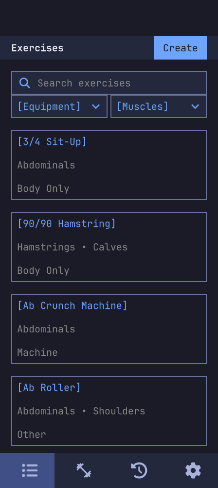
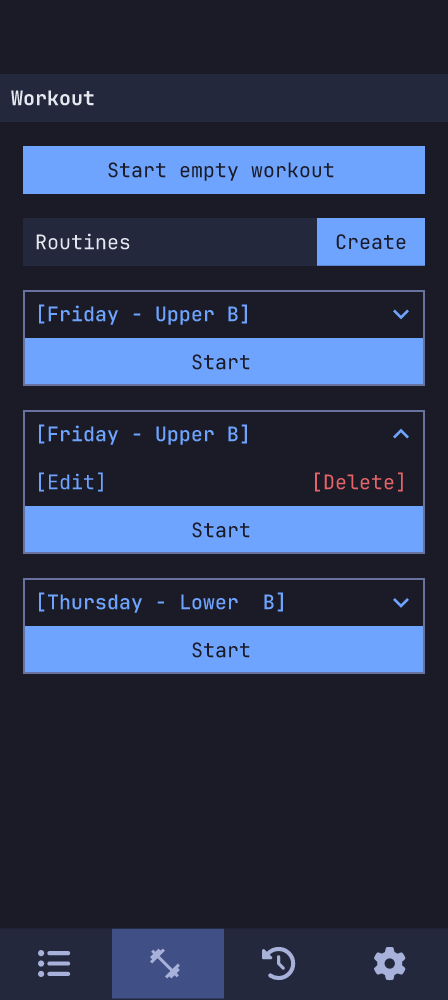
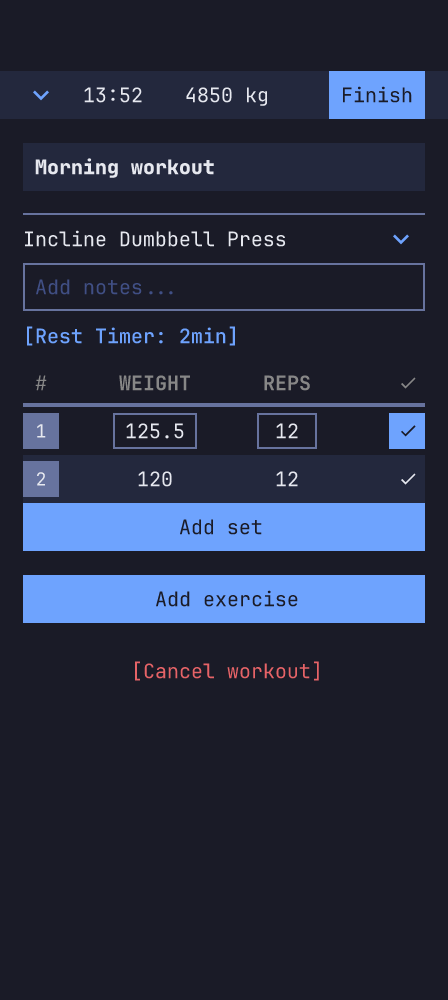
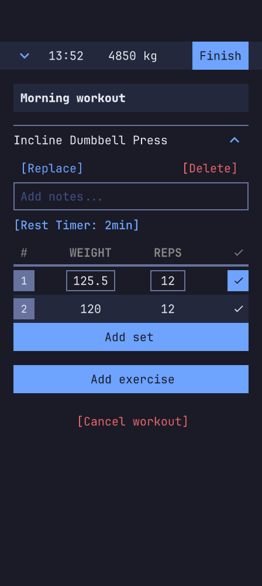
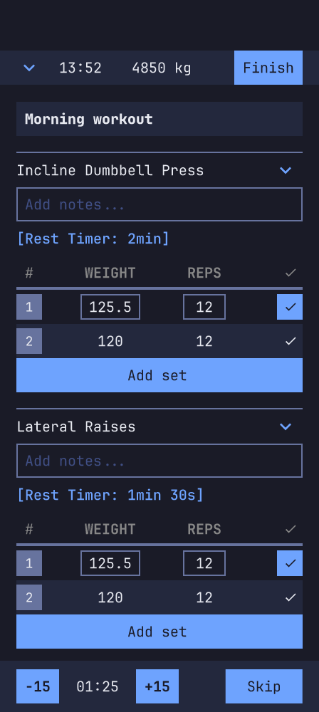

# GymTracka redesign reference

This document records the visual system and interaction decisions in the current Gymtracka Figcraft file,
reviewed on November 2, 2026. It is the reference for extending the redesign and translating it into Android UI.
It describes the target design; it does not establish which parts have been implemented or verified in the app.

The main decisions are square geometry, monospaced typography, terminal-like 48 px layout lines on a 6 × 12 grid,
flat dark surfaces, blue action buttons, bracketed text actions, and consistent alignment across workout controls.
The deliberately dark notes placeholder and the use of solid blue for available actions are approved choices.

Current application behavior remains documented in [product behavior](../../shared-docs/docs/product-behavior.md)
and [Android architecture](../architecture.md). Remaining design questions and implementation work are tracked in
[future improvements](../future-improvements.md#visual-redesign).

## Design sources

The source is **Gymtracka.figcraft**, **Page 1**. The new frames establish the design direction; imported Android
screenshots are references for the previous interface. The images below are Figcraft exports, not app screenshots.

| State | Figcraft frame | Layer ID | Preview |
|---|---|---:|---|
| Exercise catalogue with default filters | Exercises screen | 933 | [Open image](assets/exercises.png) |
| Workout landing and routines | Workouts screen | 670 | [Open image](assets/workouts.png) |
| Active workout with one exercise | Workout screen | 569 | [Open image](assets/workout.png) |
| Active workout with exercise actions expanded | Workout screen — exercise menu expanded | 863 | [Open image](assets/workout-menu.png) |
| Active workout with two exercises and a running rest timer | Workout screen | 333 | [Open image](assets/workout-rest-timer.png) |

All five reference frames are **448 × 1000 px**. Measurements in this document are Figcraft page units,
equivalent to pixels at 100% zoom. They are reference measurements, not a direct specification of Android
physical pixels or a completed mapping to dp and sp.

## Visual character

- Use square corners for buttons, fields, panels, and selected navigation backgrounds.
- Use flat surfaces, borders, and horizontal rules to organize content. Set-table headers have no drop shadows.
- Organize information in terminal-like 48 px layout lines, with text centered vertically within each line.
  Preserve this rhythm even when fewer items fit in the viewport.
- Use monospaced text throughout the redesigned screens.
- Give controls clear roles: solid accent blue for action buttons, bracketed text for text actions, and red for
  destructive actions.
- Use outlined panels for catalogue exercises and routines. Active-workout exercise sections stay on the main canvas
  with separators.

The design does not reserve solid blue for a single primary action per screen. It consistently identifies an
available button, including repeated Add set buttons and the button used to complete a set.

## Color system

Use the shared paint styles under **Workout dark**. All solid fills and strokes in the five design frames are
connected to these styles. Preserve distinct semantic styles even when their current colors match.

| Style | Color | Role |
|---|---|---|
| Background | `#1A1B27` | Main screen canvas |
| Surface | `#23283D` | Toolbars, workout title row, completed set rows, and bottom bars |
| Text | `#E6E8EF` | Main text, numeric values, and completed-state checks |
| Muted | `#878787` | Set-table headings and secondary indicators |
| Border | `#67739E` | Panel and field outlines and horizontal separators |
| Accent | `#6EA3FE` | Filled action buttons, text actions, and chevrons |
| On accent | `#1A1B27` | Labels and icons inside filled blue buttons |
| Placeholder | `#404F85` | Intentionally subdued notes placeholders |
| Selected | `#404F85` | Selected bottom-navigation background |
| Navigation icon | `#A7B1D9` | Bottom-navigation icons |
| Destructive | `#E66367` | Delete and Cancel workout actions |
| Set number background | `#67739E` | Set-number badges |

Primary text is a slightly cool off-white, and text on blue buttons is dark navy. These are palette decisions;
the design does not establish a general prohibition on pure white or pure black.

The Placeholder style intentionally retains the original dark treatment. The field remains editable; the color
does not indicate a disabled state. Placeholder and Selected share a value but are separate styles so navigation
selection and placeholder contrast can be adjusted independently. Border and Set number background are also
separate roles.

## Typography and spacing

The design font is **JetBrainsMono Nerd Font**. Most text uses a **20 px size and 24 px typographic line height**.
Each text line sits centered inside a **48 px layout line**, leaving 12 px above and below the text. The 24 px
typographic line height does not permit stacking separate information lines every 24 px.

Everything except the bottom navigation is organized into these 48 px layout lines, including headings, fields,
actions, and each line of exercise metadata. Multi-line panels use whole multiples of 48 px. Keep the 24 px gaps
specified between panels and sections; compact 24 px or 36 px controls remain centered inside a 48 px line.
Do not compress the rhythm or reduce panel height to fit the contents of an imported screenshot. Additional
content belongs below the viewport and scrolls.

Use the **6 × 12 grid** added to the Exercises frame as the alignment reference: 6 px horizontally and 12 px
vertically. In Figcraft this is represented by centered columns with size 6 px and gutter 6 px, and centered rows
with size 12 px and gutter 12 px. Align component edges, text insets, spacing, and control placement to this grid,
preserving its centered origin. The 48 px lines and 24 px section gaps follow its vertical rhythm. Border strokes
retain their specified 2 px thickness. Android system insets are handled separately.
Table headings and values start at shared character columns; do not independently center strings of different
lengths. Use one column plan across all panels on a screen and grow widths in 6 px increments. Centered action labels
snap their text block to the same horizontal grid, with wrapped lines retaining a common start edge.

| Role | Reference treatment |
|---|---|
| Screen heading | 20 px, bold |
| Workout name | 20 px, extra bold |
| Exercise name and section label | 20 px, regular |
| Button label and ordinary text action | 20 px, regular |
| Routine name link and configured rest action | 20 px, semibold |
| Weight and repetition headings | 20 px, bold, uppercase |
| Numeric inputs and workout metrics | 20 px, regular |
| Set number | 18 px, centered |

Weight, spacing, and surface treatment carry most of the hierarchy. Brackets identify a text action; they do not
require every text action to use semibold weight.

| Measurement | Reference value |
|---|---:|
| Alignment grid | 6 px horizontal × 12 px vertical |
| Layout line height | 48 px |
| Typographic line height | 24 px, centered within a layout line |
| Common internal inset | 12 px |
| Common separation between sections | 24 px |
| Main content gutter | 23 px on each side |
| Main content width | 402 px |
| Standard row or filled button height | 48 px |
| Compact numeric field height | 36 px |
| Set-number badge | 36 × 36 px |
| Complete-set button | 36 × 36 px |
| Chevron button area | 48 × 48 px |
| Chevron icon slot | 24 × 24 px |
| Typical outline | 2 px |
| Set-table heading bottom rule | 4 px |

The reference gutter is 23 px, approximately 24 px. Treat it as a shared content edge rather than independently
rounding each component. Full-width chrome can extend to the screen edge while its controls align with content.

## Control conventions

### Filled buttons

Filled buttons use Accent with On accent labels or icons. Their corners are square. Current labels include
**Start empty workout**, **Create**, **Start**, **Finish**, **Add set**, **Add exercise**, **Skip**, **-15**, and **+15**.

Use **Add set** and **Add exercise** without a leading plus. The plus in the timer's **+15** label describes the
adjustment and remains part of that label.

### Text actions

Use brackets around text actions. Current examples are `[Edit]`, `[Replace]`, `[Delete]`, `[Cancel workout]`,
`[Friday - Upper B]`, `[3/4 Sit-Up]`, and `[Rest Timer: 2min]`.

Ordinary text actions use Accent. Destructive text actions use Destructive. Brackets are a presentation
affordance; they are not added to persisted names or other domain values.

Configured rest appears as `[Rest Timer: 2min]` or `[Rest Timer: 1min 30s]`. It has no leading timer icon.
The running countdown is a separate display, such as `01:25`.

### Dialogs

App-owned dialogs use square Surface panels with the shared 2 px Border outline and monospaced typography.
Use bracketed text actions, with dismiss/clear flush left and confirmation flush right. A single action sits right.
Keep destructive actions red and disabled actions subdued. At enlarged text sizes, stack actions when they no longer
fit while retaining their respective edges; scroll long bodies above the fixed action area. Selector cards and dialog
fields also use square corners and outlines. The Android [dialog inventory](../dialogs.md) lists all variants.

### Chevrons

Use the same blue chevron family and visual size for routine actions, exercise actions, and the workout collapse
control. The chevron sits in a 24 × 24 px icon slot within a 48 × 48 px button area.

- A downward chevron on a routine or exercise title means its action row is hidden.
- An upward chevron means its action row is visible.
- The downward chevron in the top toolbar collapses the active workout.

The top-toolbar chevron uses optical alignment with the beginning of the workout title text. The title text has
a 12 px inset inside its content-width surface. Use that text edge as the shared alignment anchor for the
visible chevron and workout name.

Exercise and routine chevron button areas align with the right edge of their panels. Opening an exercise menu
reveals its actions; it does not collapse or hide the exercise's notes, rest setting, or sets.

## Set table

The table uses **#**, **WEIGHT**, **REPS**, and a completion-check heading. Keep column definitions identical
across exercises and between completed and unfinished sets.

Coordinates below are relative to a 402 px table row.

| Element | Left | Width | Height | Alignment |
|---|---:|---:|---:|---|
| Set-number badge | 0 px | 36 px | 36 px | Number centered |
| Weight field | 90 px | 84 px | 36 px | Value centered |
| Repetition field | 234 px | 60 px | 36 px | Value centered |
| Complete-set button | 366 px | 36 px | 36 px | Check centered |

Rows are 48 px high, with the compact controls 6 px from the top. Numeric text uses 6 px horizontal padding,
leaving a centered 72 px text area for weight and 48 px for repetitions. Heading text is centered over the
corresponding numeric field. Repetition containers stay 60 px wide in both states.

### Unfinished set

- Weight and repetition values have compact outlined fields.
- The complete-set action is a solid blue square containing a dark check icon.
- The set-number badge uses Set number background and Text.

The blue square is an action button that completes the set. Its fill does not mean the set is already completed.

### Completed set

- The row uses Surface.
- Weight and repetition values retain the same column widths and centers, with their input outlines hidden.
- A plain off-white check replaces the filled completion button, centered on the same column.
- The set-number badge remains 36 × 36 px.

Completion changes the row treatment without moving the values. The mockup does not redefine whether domain
edits are allowed or how completion is reversed; preserve the existing behavior documented in
[product behavior](../../shared-docs/docs/product-behavior.md#workouts).

## Screen composition

### Exercise catalogue

The **Exercises** heading sits in a full-width 48 px Surface bar, with a square blue **Create** button on the
right. Its text and button align with the shared 23 px content gutters. As in the workout landing frame, the
bar begins 74 px below the frame top; Android system insets must be handled separately.

The content column contains a 402 × 48 px outlined search field, followed immediately by a 48 px filter line.
Its two filter controls are each 198 px wide, with a 6 px horizontal gap to align their edges with the grid.
Search has a blue search icon and Muted placeholder text. The square filter controls use
Surface, a 2 px Border outline, bracketed Accent labels (`[Equipment]` and `[Muscles]`), and the shared blue
chevron in a 24 px slot within a 48 px disclosure area. These labels identify the filter categories; the frame
shows the default state with no selections. Leave 24 px below the heading bar before search and 24 px between
the filter line and the catalogue.

Each exercise is a square **402 × 144 px panel** with a **2 px inside Border stroke**, separated from the next
panel by **24 px**. Its three 48 px layout lines are:

1. Clickable exercise title in Accent, enclosed in square brackets, such as `[3/4 Sit-Up]`.
2. Muscle groups in Muted, retaining the ` • ` separator between primary and secondary groups.
3. Equipment in Muted.

Use a 12 px horizontal text inset, regular 20 px monospaced text, and a 24 px typographic line height centered
within each 48 px line. Text begins at vertical offsets 12, 60, and 108 px inside the panel. There are no extra
rules between the three lines. The title action belongs to its 48 px line; brackets are presentation only.

The catalogue begins at y = 266 px. Its 648 px viewport shows four full panels; the remaining three exercises
from the imported screenshot stay below the viewport in the scrolling catalogue. Preserve panel dimensions
and spacing instead of fitting all seven exercises into the frame.

The fixed 72 px bottom navigation uses the same four equal-width destinations as the workout landing frame,
with **Exercises** selected. Search, filter draft/apply behavior, catalogue navigation, and custom-exercise
creation retain their existing product behavior. Selected filters, filter dialogs, search results, and other
catalogue states still need matching designs.

The Android exercise pickers reuse the catalogue's search field, inline filters, panel layout and typography.
Their title strip offers Cancel, and a fixed rectangular action confirms the selected exercises. Selected panels use
the navigation-selection blue, an Accent border and a trailing Material check. The full panel toggles selection;
replacement permits one selection. These picker states derive from the catalogue design rather than a separate frame.

### Workout landing

The **Workout** heading sits in a full-width surface bar. The content column contains Start empty workout,
followed by a Routines section bar with Create on the right.

Routine panels use a 2 px Border outline, a 48 px title row, and a full-width 48 px Start button. A collapsed
panel is 96 px high. Expanding it inserts a 48 px action row, producing a 144 px panel:

1. Bracketed routine name and upward chevron.
2. `[Edit]` on the left and `[Delete]` on the right.
3. Start button.

The current mockup omits the exercise summaries shown in the old routine cards. Whether to retain a preview
in the redesigned panel remains an [open design question](../future-improvements.md#visual-redesign).

Bottom navigation uses four equal-width icon-only destinations: **Exercises**, **Workout**, **History**, and
**Settings**. In the 448 px frame each destination is 112 px wide, with 36 px icons and a 72 px bottom bar.
The selected destination fills its rectangular area with Selected; icon tint remains Navigation icon.

### Active workout

The top toolbar spans the full 448 px frame. It contains the collapse chevron, elapsed time, derived volume,
and Finish. Finish shares its right edge with the set-completion buttons and the content column, 23 px inside
the screen edge.

The workout title occupies a full 48 px Surface row. Leave 24 px between the toolbar and that row, and use
12 px internal horizontal padding for the title text. A 24 px separator region follows the title before the
first exercise.

Each exercise contains, in order:

1. Exercise title and action chevron.
2. Expanded actions, when open.
3. Notes field.
4. Bracketed configured-rest action.
5. Set-table heading and set rows.
6. Full-width Add set button.

Closed exercise sections in the examples are 336 px high with two set rows. Opening the action menu adds
48 px, making the example 384 px high. Section height grows with its content.

The expanded action row uses blue `[Replace]` flush with the content's left edge, blue `[History]` centered,
and red `[Delete]` flush with the right edge. The center action is spelled out in Android; the source frame currently
abbreviates it as `[Hist]`. Text actions have no horizontal inset. Everything beneath the row shifts down by 48 px.
Use this inline disclosure in place of the previous three-dot exercise menu.
At enlarged Android text sizes, stack actions when needed to preserve whole labels and their horizontal alignment.

Exercise history reuses the catalogue's square 2 px Border panels, 12 px internal text insets and 24 px panel gaps.
Its compact rows use 24 px layout lines, half the catalogue's row pitch, with 12 px top and bottom panel insets.
Add a 24 px gap before the set-table header to restore the larger separation from the workout metadata.
Rows grow for wrapped or enlarged text. Panels contain a workout name, date, optional exercise notes and the performed sets
in three columns: set number, weight in kilograms and repetitions. Use the same monospaced text and dark canvas.
Workout panels are read-only; their names are ordinary text rather than bracketed links.
The back arrow's visible left edge aligns with the panel title text inset, in both exercise history and workout
summary. Optically shift the Material arrow 3 reference units left inside its button to account for its vector inset.

Add exercise and `[Cancel workout]` follow the exercise list and scroll with it. Preserve the spacing and
alignment when exercises are inserted, removed, or expanded.

### Settings

Settings uses the shared Surface title strip and a scrolling column of Connection, Sync and Account panels.
Match the history panels: square 2 px Border outlines, 23 px outer gutters, 12 px text insets, 48 px information/action
rows and 24 px panel gaps. Section titles are bold. Keep ordinary values in Text and secondary last-success metadata
in Muted; preserve the green/red/yellow connection indicator. Long timestamps, explanations and action labels wrap
on a common left edge and grow on the grid at enlarged text sizes.

Use bracketed text actions without leading icons: `[Check]`, `[Sync now]`, `[Reauthenticate]` and the existing
cancellation/recovery actions. Destructive recovery confirmation stays red; unavailable actions stay subdued.
Busy operations use thin square-ended progress bars. Recovery warnings remain beside their actions inside the Sync
panel. The fixed heading and measured bottom navigation/workout panel frame the scrolling content.

### Collapsed workout

The current-workout panel sits above bottom navigation with the shared 23 px gutters and 12 px vertical gaps.
Use a square Surface panel with a 2 px Border outline and no shadow. A blue bracketed workout name occupies the
first 48 px layout line and wraps for long names. Beneath it, show Muted elapsed time on the left, an Accent rest
countdown when active, and red `[Discard]` flush right. Keep numeric countdowns intact. When the labels no longer
fit one row, move the metrics above the right-aligned action and stack the metrics if needed. Preserve the 6 × 12
grid and let the panel grow with text size. Reserve its measured height above navigation instead of covering content.
The panel resumes the workout; Discard opens the existing confirmation.

### Routine editing

Routine creation/editing follows the active-workout grid: a Surface toolbar with Cancel and a square blue Save action,
a Surface name field after a 24 px gap, exercise separators, bracketed configured rest and square outlined compact
set inputs. Match the workout field widths (84 px weight / 60 px reps, with Android enlarged-text widths of 144 / 96)
and keep them centered below their headings. Each exercise heading has one visible red `[Delete]` action, with confirmation. Use three aligned
`# / WEIGHT / REPS` columns and filled Add set/Add exercise actions. Set rows share workout swipe deletion, revealing
a red area and deleting after release past halfway; omit a permanent bin button. Routine sets have no completion control.

Read-only routine details follow the workout summary: a Surface toolbar labeled Routine details, the routine name
above square outlined exercise panels, and a fixed rectangular Start routine action aligned with the content gutters.
Use the same compact panel spacing and optically aligned back arrow. Show configured Rest Timer below each exercise
name and use the shared three-column `# / WEIGHT / REPS` table, with matching column starts across every panel.

### Running rest timer

The running-timer example anchors a 72 px Surface bar to the screen bottom. It contains a -15 button,
countdown, +15 button, and a separate Skip button at the right. Buttons are 48 px high and use Accent with
On accent content. Exercise content stays above the bar.

Configured rest and elapsed recorded rest remain distinct concepts. The redesign changes presentation;
timer ownership, persistence, collapse behavior, vibration, and wake-lock behavior remain governed by the
[existing timer lifecycle](../architecture.md#rest-timer-lifecycle).

### Workout history

The Android History tab extends the same dark visual system: a full-width Surface heading, monospaced text,
402 px content width, square 2 px Border panels and 24 px gaps. Workout titles are bracketed Accent links with a
blue disclosure chevron. Expanding a title inserts `[Save]` at the left, `[Perform]` at the center and destructive
`[Delete]` at the right, within the panel's 12 px horizontal insets. Use the same responsive action layout as active
workout exercises, stacking enlarged labels when needed.

Date and time occupy separate compact rows. For each exercise, put `count × exercise name` on a full-width
row and `Best set: weight × repetitions` on the next, allowing names to wrap. Duration and volume use separate
labeled rows. Match exercise-history panel content spacing with 24 px rows and 24 px gaps between metadata,
exercise summaries and workout totals; use 12 px between exercise groups. These history layouts are Android
extensions of the current visual system and do not have a separate source frame in the reference gallery.

The workout title opens a **Workout summary** screen using the exercise-history surface toolbar, compact outlined
panels and monospaced grid. Put workout name/date/time above the exercise panels and duration/volume below them.
Each panel has an exercise name, optional notes, a 24 px gap and a four-column `# / WEIGHT / REPS / REST` table.
Use recorded elapsed rest between sets; leave each exercise's final rest cell blank. Missing earlier rest displays a
dash. Share table alignment with exercise history, allowing horizontal scrolling when enlarged text requires it.
Keep a rectangular Perform again action in the fixed bottom surface bar, aligned with the 23 px content gutters.

## Android translation

Use this reference with the repository's existing UI boundaries and conventions:

- Translate the reference dimensions into responsive dp and sp values. Account for Android status bars,
  bottom insets, and the keyboard separately from the 448 × 1000 reference frame.
- Keep compact set editors based on `CompactSetTextField` and `BasicTextField`. Use the existing locale-aware
  formatting and parsing helpers, and center values within their stable columns.
- Use Material icons from `material-icons-extended` for production controls. The Figcraft Nerd Font glyphs
  are visual references; match their visual shape and slot size with actual icons.
- Give icon-only controls accessible names and expose selected, expanded, and completion states. Distinguish
  visual bounds from the interactive area when preserving compact controls.
- Keep presentation changes within the existing screen and state-holder boundaries. Preserve autosave,
  confirmations, navigation, and timer behavior through the existing state and repository interfaces.

See [UI and state flow](../architecture.md#ui-and-state-flow) for current implementation details and
[testing strategy](../testing-strategy.md) for verification layers.

## Maintaining the design file

Apply shared paint styles to new fills and strokes. Use the existing text styles as a starting point and preserve
the role-specific weights above. Repeated table columns, button sizes, and menu rows should derive from the
same measurements across frames.

When changing a component, update each example state that contains it. The expanded exercise-menu frame is
a variant of the single-exercise frame, with the action row and its required content shift as the intended
difference. Keep frame previews in this folder in sync with intentional design changes.

### Work surface and imported images

Page guides and snapping organize frames and screenshots on the Figcraft work surface. They are editor aids;
their positions are not app layout tokens and they do not belong in exported UI artwork.

The background-grid command did not render a grid in the design file during this review, so page guides were
used for rows and columns. The reviewed guide controls expose no color or opacity setting. A faded-gray
workspace grid is a desired editor treatment, not a change to the app palette.

Preserve the aspect ratio of imported screenshots. For example, a 1080 × 2410 capture scaled to a height of
1000 px is approximately 448.13 px wide. This fractional width is expected and is slightly different from the
448 px mockup width. The small sizing discrepancy investigated during the review was in a canvas layer's
scaling; the source captures checked had identical pixel dimensions.

## Reference gallery

Open a preview from the [source table](#design-sources) for its full-size image.
The expanded-actions preview predates the three-action row; use the current action-row specification above for
its alignment and History action.

| Exercises catalogue |
|---|
|  |

| Workout landing | Active workout |
|---|---|
|  |  |

| Expanded exercise actions | Running rest timer |
|---|---|
|  |  |
